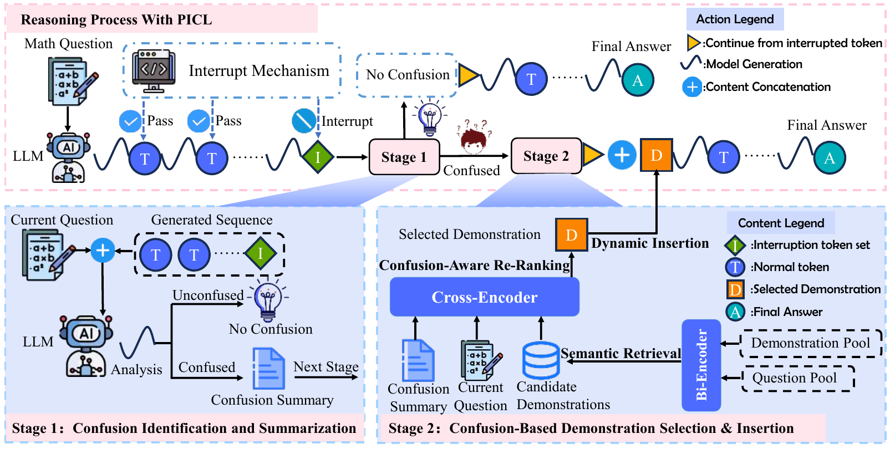

# Process In-Context Learning (PICL)

This repository contains the implementation of **Process In-Context Learning: Confusion-Aware Demonstration Retrieval and Dynamic Insertion for Mathematical Reasoning**, published at **CIKM 2026**.

PICL detects confusion during mathematical reasoning, retrieves demonstrations that address the current difficulty, and inserts them into the ongoing reasoning process.



*Figure 2 from the camera-ready paper. PICL combines confusion identification and summarization with confusion-aware demonstration selection and dynamic insertion.*

## Running PICL

The runnable workflow consists of three files:

- `PICL/run_Picl.py`: runs both stages, or either stage separately.
- `PICL/Semantic_retrieval.py`: caches the top-N semantic candidates for each question.
- `PICL/Evaluate.py`: runs confusion detection, reranking, insertion, and evaluation.

Semantic retrieval is precomputed because it depends only on the question and demonstration pool. The confusion summary is used later during reranking.

### 1. Prepare the environment and models

Use a Linux environment with CUDA GPUs for vLLM inference. Install a CUDA-compatible PyTorch build and the dependencies in your Python environment:

```bash
python -m pip install -r requirements.txt
```

Prepare these models, either as local directories or Hugging Face model IDs:

| Component | Model |
| --- | --- |
| Reasoning model | `deepseek-ai/DeepSeek-R1-Distill-Qwen-7B` or `deepseek-ai/DeepSeek-R1-Distill-Llama-8B` |
| Semantic encoder | `bert-base-uncased` |
| Confusion-aware reranker | `BAAI/bge-reranker-v2-m3` |

Local model directories allow offline runs. Dataset files and model weights are not included in this repository.

### 2. Prepare the data

Place the benchmark JSON files in one directory, such as `DEmO_data/`. The paper's mathematical benchmarks and multiple-choice extensions use the following files and fields:

| `--task` | Files | Required fields in each sample |
| --- | --- | --- |
| `gsm8k` | `gsm8k_train.json`, `gsm8k_test.json` | `question`, `answer` (worked solution), `label` (final answer) |
| `math500` | `math500.json` | `problem`, `solution`, `answer` |
| `amc` | `amc.json` | `question`, `solution`, `answer` (integer or integer string) |
| `aime` | `aime.json` | `Problem`, `Solution`, `Answer` |
| `mmlu_math` | `mmlu_math.json` | `question`, `choices` (list), `answer` (zero-based index) |
| `mmlu_pro` | `mmlu_pro.json` | `question`, `choices` (list), `answer` (uppercase option letter) |

### 3. Run the complete pipeline

Run the following from the repository root, replacing the data and model paths as needed:

```bash
python PICL/run_Picl.py \
  --stage all \
  --gpu 0 \
  --task gsm8k \
  --data_path /path/to/DEmO_data \
  --saving_path ./output/gsm8k/picl \
  --embedding_model_path bert-base-uncased \
  --model_path deepseek-ai/DeepSeek-R1-Distill-Qwen-7B \
  --reranker_model_path BAAI/bge-reranker-v2-m3 \
  --retrieval_shots 32 \
  --r 1 \
  --k 1 \
  --max_model_len 20000 \
  --gpu_memory_utilization 0.83
```

This first creates the candidate cache, then runs PICL. The default evaluates all questions. Add `--m 100` to evaluate only the first 100 questions. The commands above use Bash line continuations.

### 4. Run the stages separately

Build the semantic candidate cache:

```bash
python PICL/run_Picl.py \
  --stage retrieval \
  --gpu 0 \
  --task gsm8k \
  --data_path /path/to/DEmO_data \
  --saving_path ./output/gsm8k/picl \
  --embedding_model_path bert-base-uncased \
  --retrieval_shots 32
```

Run PICL using that cache:

```bash
python PICL/run_Picl.py \
  --stage picl \
  --gpu 0 \
  --task gsm8k \
  --saving_path ./output/gsm8k/picl \
  --model_path deepseek-ai/DeepSeek-R1-Distill-Qwen-7B \
  --reranker_model_path BAAI/bge-reranker-v2-m3 \
  --r 1 \
  --k 1
```

Use the same task and saving directory for both stages. Rerun retrieval if the dataset, semantic encoder, or candidate count changes.

### Parameters and outputs

| Parameter | Meaning | Default |
| --- | --- | --- |
| `--retrieval_shots` | Candidate count N; called `--shots` in `Semantic_retrieval.py` | 32 |
| `--r` | Maximum confusion-detection/intervention cycles per question | 1 |
| `--k` | Maximum demonstrations inserted per confirmed confusion | 1 |
| `--m` | Number of evaluation questions | All |
| `--max_model_len` | Total context limit, including inserted demonstrations | 20000 |
| `--max_tokens` | Maximum new tokens per generation call, capped by remaining context | 20000 |
| `--gpu_memory_utilization` | GPU memory fraction reserved by vLLM; leave room for the reranker | 0.83 |
| `--seed` | Random seed | 317 |

The paper's main setting uses `r=1` and `k=1`, with temperature 0.7 and top-p 0.8. N=32 is the release's candidate-cache default. PICL starts with no demonstrations and inserts up to k only after a nonempty confusion summary. 
